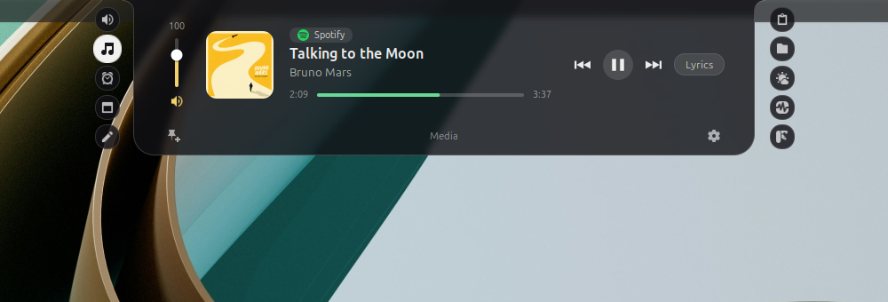
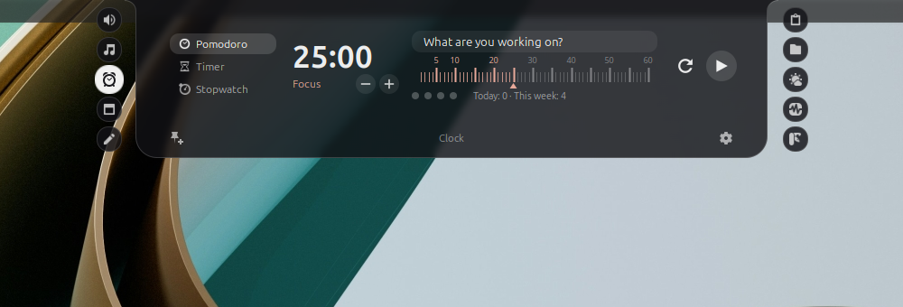
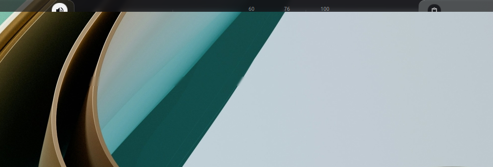
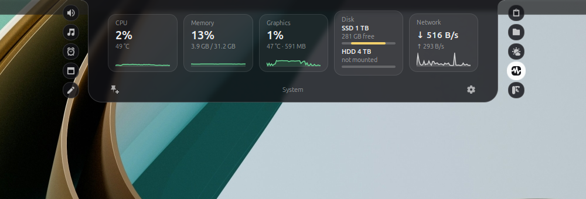
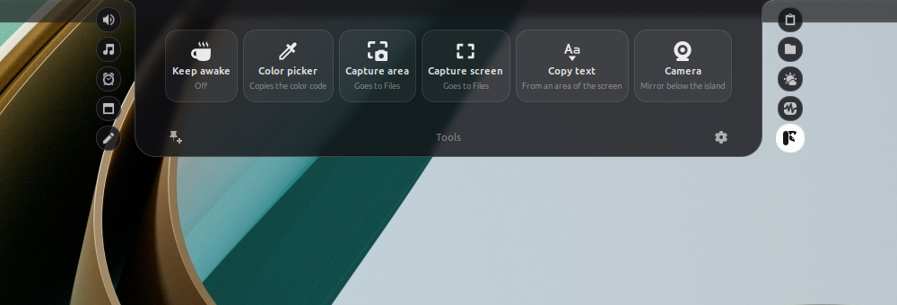

# Cinnamon Island



A dynamic island for the Cinnamon desktop: a glass notch on the screen edge that expands into tabs on hover. Inspired by the notch apps on the Mac, built for Linux Mint and designed for desktop PCs, with no physical notch needed.

*[Leia em português](README.pt-BR.md).* The interface is available in English and Brazilian Portuguese and follows the system language.

## What it does

| Tab | What it does |
| --- | --- |
| Volume | A mixer: audio outputs, master volume, microphone and one bar per program |
| Media | Controls what is playing (Spotify, browser, VLC…), with synced lyrics |
| Clock | Pomodoro with task and statistics, timer and stopwatch |
| Agenda | The month and the upcoming events, read from an iCal link |
| Notes | A block of text that saves itself |
| Clipboard | History of what was copied; strips trackers from links |
| Files | A drag-and-drop shelf |
| Weather | Forecast for up to five cities, from Open-Meteo |
| Notifications | An inbox for the system notifications (off by default; turn it on in the settings) |
| System | CPU, memory, graphics card, disks, network and battery, with graphs |
| Tools | Keep the screen awake, colour picker, screenshots, copy text from the screen and a camera mirror |

| | |
| --- | --- |
|  |  |
|  |  |


While closed, the island shows the album cover and wave bars of the music, the time of the clock, the countdown to the next event and short notices (download finished, microphone muted, new notification).

## Requirements

- Linux Mint or another distribution with Cinnamon 6.0 or newer, in an X11 session (it does not work on Wayland or on other desktops)
- Python 3.9+, PyGObject and GTK 3 (already in Mint)
- `pactl`, `paplay` and `parec` (package `pulseaudio-utils`), with PipeWire or PulseAudio

Optional, each for one feature:

| Package | What for |
| --- | --- |
| `python3-dateutil` | Recurring events in the agenda |
| `gnome-screenshot` | Screenshots |
| `tesseract-ocr` (plus language packs such as `tesseract-ocr-por`) | Copy text from the screen |
| `gstreamer1.0-plugins-good`, `gstreamer1.0-gtk3` and `gir1.2-gstreamer-1.0` | Camera mirror |

## Install

Download the packages from the [latest release](https://github.com/rovillela-afk/cinnamon-island/releases/latest).

**From the .deb package** (extension and engine system-wide):

```bash
sudo apt install ./cinnamon-island_0.1.0_all.deb
```

Then enable "Cinnamon Island" in System Settings → Extensions. The island starts the engine by itself.

**From the .zip file** (your user only): extract `cinnamon-island@rovillela.zip` into `~/.local/share/cinnamon/extensions/` and enable "Cinnamon Island" in System Settings → Extensions.

**For development**: clone the project and run `./install.sh`. It links the project folder into Cinnamon and installs the engine as a user service; run it again after every change. `./install.sh --remove` undoes it.

## How to use

- Hover over the island to open it; it collapses when the mouse leaves. Super+I opens and pins it, and then the arrow and number keys switch tabs.
- The orbs on the sides are the tabs. The mouse wheel switches tabs, or changes the control under the pointer (bar, ruler, list).
- The pin, in the bottom left corner, keeps the island open. The gear, on the right, opens the settings.
- Drag a file onto the closed island and it opens on the Files tab.

## Privacy and security

The app has no account, collects no usage data and shows no ads. What it reaches on the internet and what it stores on your computer is detailed in [SECURITY.md](SECURITY.md), together with how to report a vulnerability.

## How it is built

The island has two halves. The **engine** (`engine/`, in Python) reads the system and exposes each tab over D-Bus at `org.cinnamonisland.Engine`. The **extension** (`extension/`, in JavaScript) only draws. The idea is that other desktops can get their own front end on top of the same engine.

- [PLAN.md](PLAN.md): what is done, the decisions and their reasons, the known limits and what may come next.
- [CLAUDE.md](CLAUDE.md): rules and quirks for anyone touching the code. The project was written with the help of Claude Code, and that file is what it reads before working.

`./package.sh` builds in `dist/` the extension .zip (with the engine inside), the folder in the Cinnamon store layout and the .deb.

## Contributing

Bugs and suggestions: open an issue on GitHub. For security problems, see [SECURITY.md](SECURITY.md). Code, comments and documentation are in English; the interface strings are English in the code, with translations in `po/`.

## License

GPL-3.0-or-later. See [LICENSE](LICENSE).
