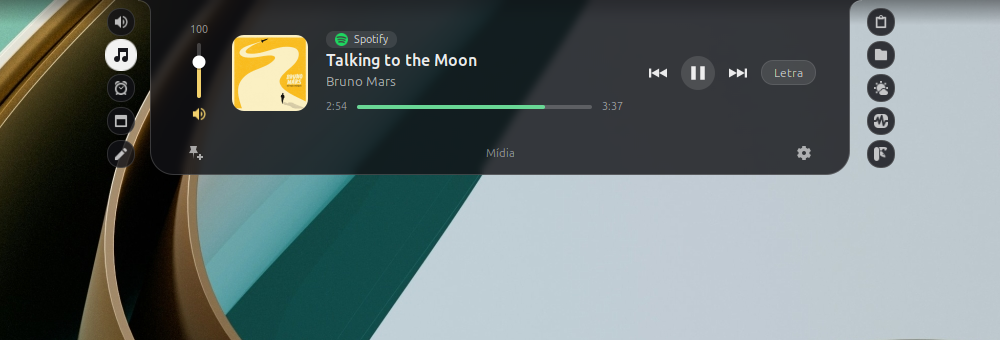
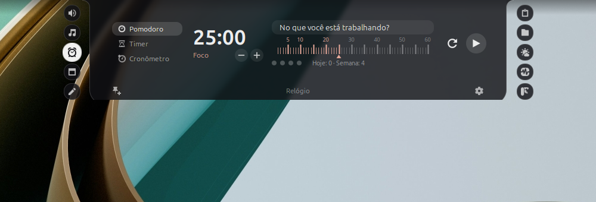
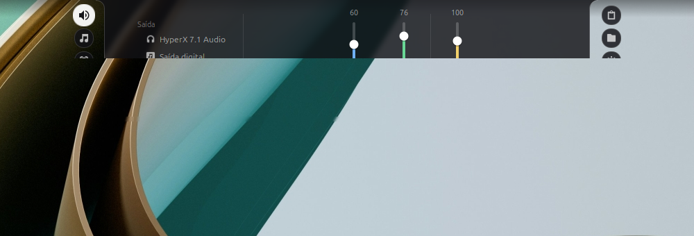
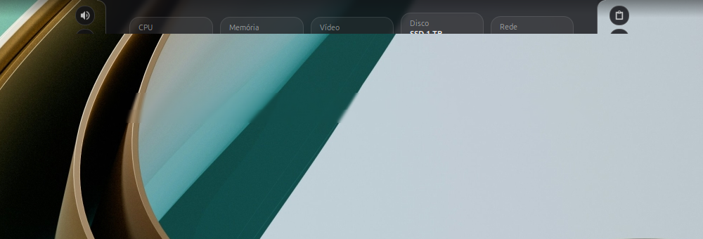
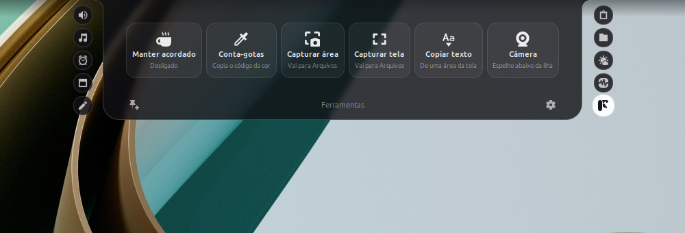

# Cinnamon Island



Dynamic island para o Cinnamon: um notch de vidro encostado na borda da tela que expande em abas ao passar o mouse. Inspirado nos apps de notch do Mac, feito para o Linux Mint e pensado para PC de mesa, sem depender de um notch físico.

*[Read this in English](README.md).* A interface do app está em português e em inglês, e segue o idioma do sistema.

## O que tem

| Aba | O que faz |
| --- | --- |
| Volume | Mesa de som: saídas de áudio, volume geral, microfone e uma barra por programa |
| Mídia | Controla o que está tocando (Spotify, navegador, VLC…), com letra sincronizada |
| Relógio | Pomodoro com tarefa e estatísticas, temporizador e cronômetro |
| Agenda | O mês e os próximos compromissos, lidos de um link iCal |
| Notas | Bloco de texto que salva sozinho |
| Clipboard | Histórico do que foi copiado; tira rastreadores de links |
| Arquivos | Prateleira de arrastar e soltar |
| Clima | Previsão de até cinco cidades, pela Open-Meteo |
| Notificações | Caixa de entrada das notificações do sistema (desligada por padrão; ligue nas configurações) |
| Sistema | CPU, memória, placa de vídeo, discos, rede e bateria, com gráficos |
| Ferramentas | Manter a tela acordada, conta-gotas, capturas, copiar texto da tela e espelho da câmera |

| | |
| --- | --- |
|  |  |
|  |  |


Fechada, a ilha mostra a capa e as ondinhas da música, o tempo do relógio, a contagem para o próximo compromisso e avisos curtos (download terminado, microfone mudo, notificação nova).

## Requisitos

- Linux Mint ou outra distribuição com Cinnamon 6.0 ou mais novo, em sessão X11 (não funciona em Wayland nem em outros ambientes)
- Python 3.9+, PyGObject e GTK 3 (já vêm no Mint)
- `pactl`, `paplay` e `parec` (pacote `pulseaudio-utils`), com PipeWire ou PulseAudio

Opcionais, cada um para uma função:

| Pacote | Para quê |
| --- | --- |
| `python3-dateutil` | Compromissos repetidos na agenda |
| `gnome-screenshot` | Capturas de tela |
| `tesseract-ocr` e `tesseract-ocr-por` | Copiar texto da tela |
| `gstreamer1.0-plugins-good`, `gstreamer1.0-gtk3` e `gir1.2-gstreamer-1.0` | Espelho da câmera |

## Instalação

Baixe os pacotes na [última versão publicada](https://github.com/rovillela-afk/cinnamon-island/releases/latest).

**Pelo pacote .deb** (extensão e motor no sistema):

```bash
sudo apt install ./cinnamon-island_0.1.0_all.deb
```

Depois ative "Cinnamon Island" em Configurações do Sistema → Extensões. A ilha liga o motor sozinha.

**Pelo arquivo .zip** (só para o seu usuário): extraia `cinnamon-island@rovillela.zip` em `~/.local/share/cinnamon/extensions/` e ative "Cinnamon Island" em Configurações do Sistema → Extensões.

**Para desenvolver**: clone o projeto e rode `./install.sh`. Ele liga a pasta do projeto ao Cinnamon e instala o motor como serviço do usuário; rode de novo depois de cada mudança. `./install.sh --remove` desfaz.

## Como usar

- Passe o mouse na ilha para abrir; ela recolhe quando o mouse sai. Super+I abre e fixa, e aí as setas e os números do teclado trocam de aba.
- As bolinhas dos lados são as abas. A rodinha do mouse troca de aba, ou mexe no controle que estiver embaixo do ponteiro (barra, régua, lista).
- O alfinete, no canto de baixo à esquerda, mantém a ilha aberta. A engrenagem, à direita, abre as configurações.
- Arraste um arquivo para a ilha fechada e ela abre na aba Arquivos.

## Privacidade e segurança

O app não tem conta, não coleta dados de uso e não mostra anúncios. O que ele acessa na internet e o que guarda no seu computador está detalhado em [SECURITY.md](SECURITY.md) (em inglês), junto com o jeito de avisar sobre uma falha.

## Como é feito

A ilha tem duas partes. O **motor** (`engine/`, em Python) lê o sistema e expõe cada aba por D-Bus em `org.cinnamonisland.Engine`. A **extensão** (`extension/`, em JavaScript) só desenha. A ideia é que outros ambientes possam ganhar sua própria "cara" usando o mesmo motor.

- [PLAN.md](PLAN.md) (em inglês): o que está pronto, as decisões e seus motivos, os limites conhecidos e o que pode vir depois.
- [CLAUDE.md](CLAUDE.md) (em inglês): regras e particularidades para quem mexe no código. O projeto foi escrito com a ajuda do Claude Code, e esse arquivo é o que ele lê antes de trabalhar.

`./package.sh` monta em `dist/` o .zip da extensão (com o motor dentro), a pasta no formato da loja do Cinnamon e o .deb.

## Contribuir

Problemas e sugestões: abra uma issue no GitHub. Para falhas de segurança, veja o [SECURITY.md](SECURITY.md).

## Licença

GPL-3.0-or-later. Veja [LICENSE](LICENSE).
